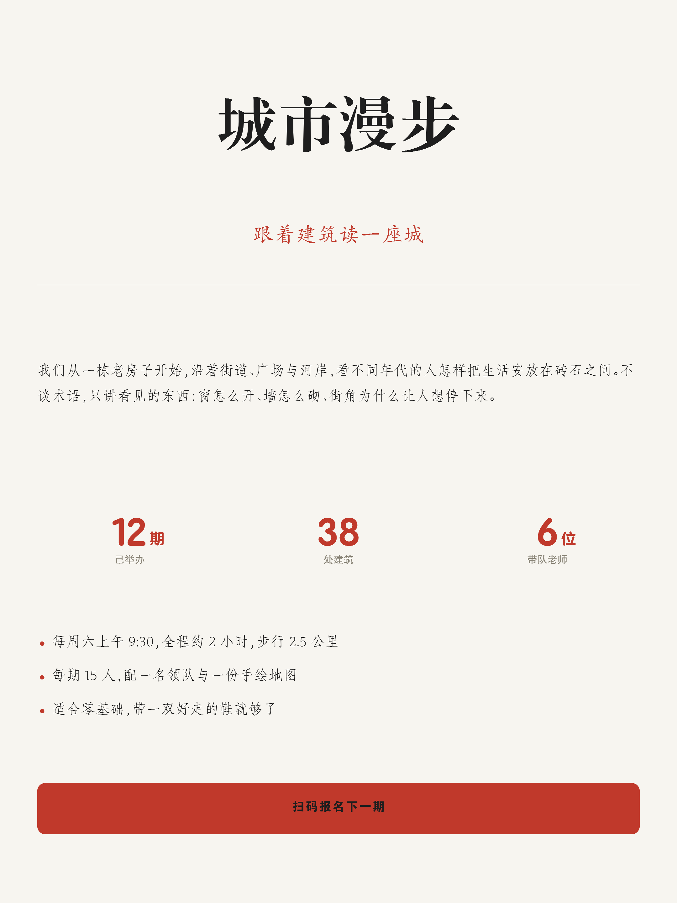
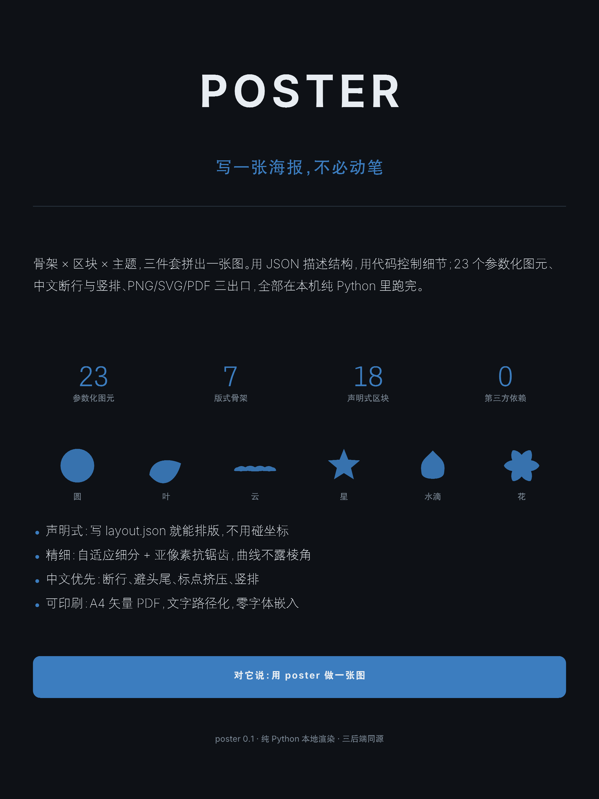
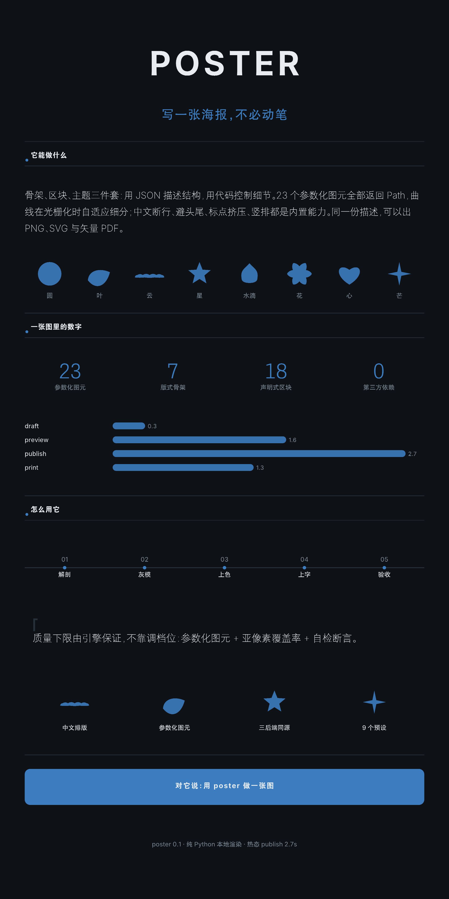
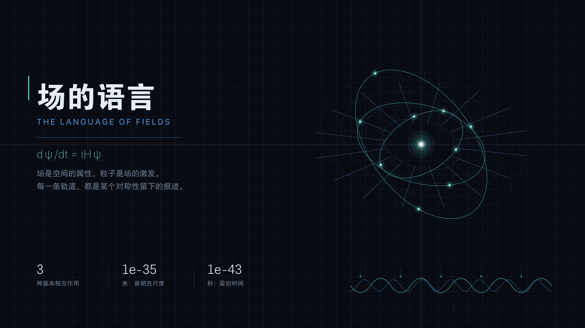
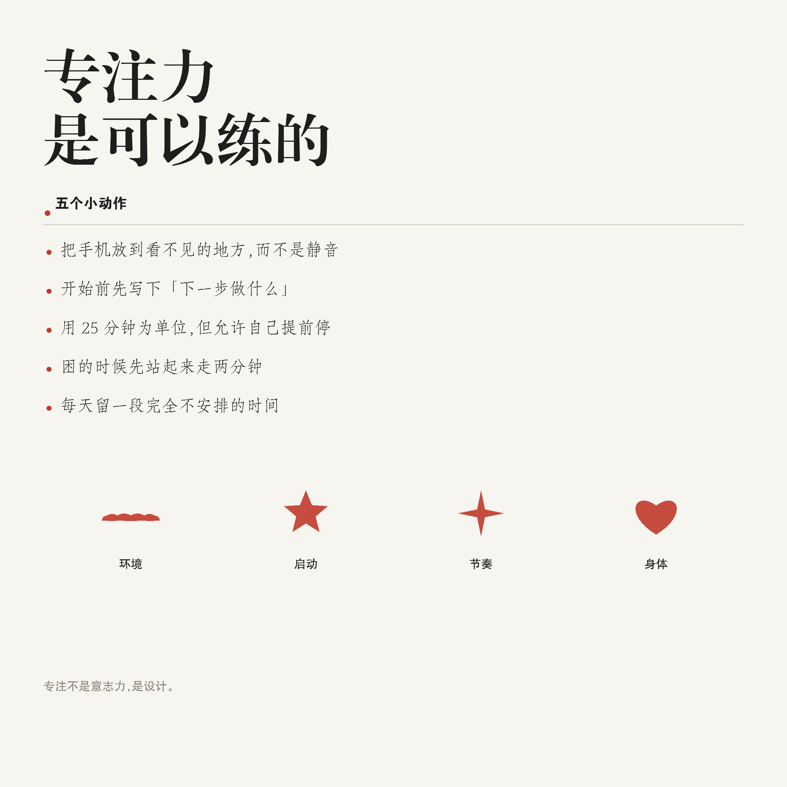
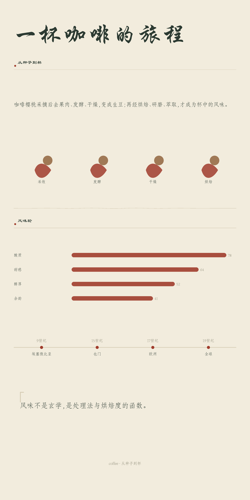
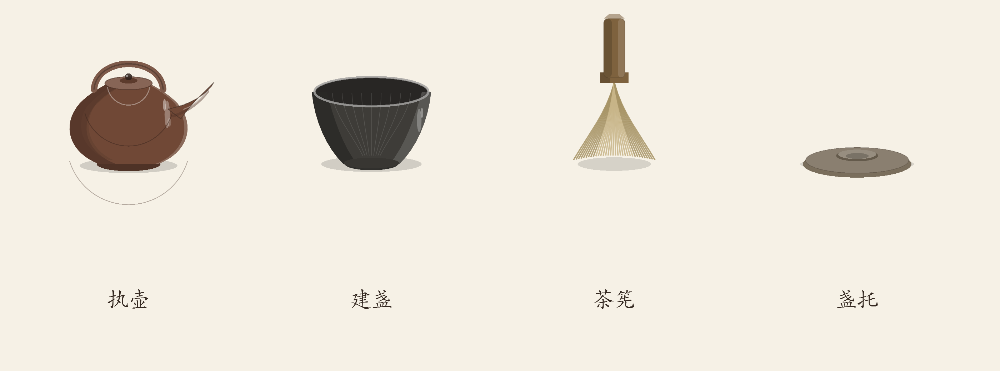
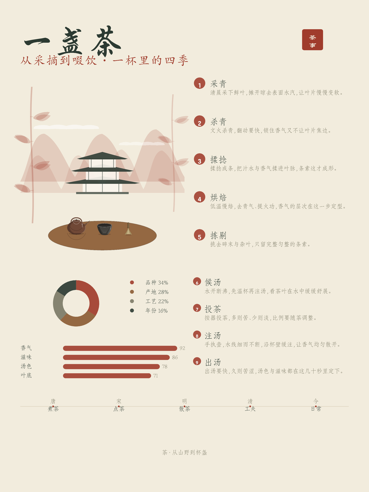

# poster

纯 Python 的海报 / 信息长图渲染引擎。声明式「骨架 + 区块 + 主题」，或直接调用 Canvas 自由绘制；输出 PNG / SVG / PDF，零第三方依赖（只有 fontTools）。

A pure-Python poster / infographic engine: declarative layout (skeleton × blocks × theme) or free-form Canvas drawing, with PNG / SVG / PDF output and a local rasterizer. Only dependency: fontTools.

```bash
git clone https://github.com/KongBai-lab/dsh-skill-poster.git
cd dsh-skill-poster && pip install -r requirements.txt
```

> 字体不随仓库分发，引擎读取系统已安装字体（默认扫描 `/system/fonts`、`/usr/share/fonts` 等常见目录，可用 `POSTER_FONT_DIR` 指定）。



## 特性

- **两种用法**：写 `layout.json` 组装（快、标准），或直接画（版式独一无二）
- **23 个参数化图元**：圆 / 弧 / 环 / 叶 / 花瓣 / 云 / 山 / 涟漪 / 印章框…
- **中文排版**：像素级断行、避头尾、标点挤压、竖排、字距
- **三出口**：PNG（本地光栅化）、SVG（可再编辑）、PDF（矢量）
- **风格参数化**：7 组参数（配色 / 字体 / 形状 / 深度 / 装饰 / 密度 / 点缀），6 套内置风格
- **参考图取色**：给一张图，自动出主题草稿（配色 / 明暗 / 版心 / 密度）
- **图片素材**：`cv.image()` 贴背景，PNG 全质量 / JPEG 直嵌 PDF
- **自检**：越界、对比度、字号、色数、缺字、slot 完整性

## 示例

| | |
|---|---|
|  |  |
| 产品宣传（数字 + 图元 + 特性） | 图元陈列（展示 23 个图元） |
|  |  |
| 科技 / 物理风封面（C 模式自绘） | 方形知识卡 |
|  |  |
| 信息长图（图表 + 时间轴） | 半写实器物（六层绘制） |
|  | |
| 场景长图（左场景 + 右工序 + 图表） | |

## 快速开始

```bash
pip install fonttools

# 渲染自带模板
python -m engine.render templates/minimal-poster/layout.json -o out.png --for publish

# 带自检
python -m engine.render templates/poster-promo/layout.json -o out.png --check
```

```python
from engine.canvas import Canvas
from engine import geometry as G, typography as T

cv = Canvas(1080, 1440, ss=3, bg=(247, 245, 240))
cv.fill(G.circle(540, 500, 160), (58, 84, 66))
cv.fill(T.text_path("标题", 540, 820, 72, "hei", "bold", align="center"),
        (32, 28, 24), rule="evenodd")
cv.to_png("out.png")
```

## 目录

```
engine/         引擎核心
  path.py       Path + 自适应细分
  canvas.py     显示列表（fill / stroke / clip / image）
  geometry.py   23 个参数化图元
  fonts.py      字体注册 + 字形→Path + 缺字检测
  typography.py 断行 / 避头尾 / 标点挤压 / 竖排
  theme.py      主题与画布预设
  blocks.py     21 个声明式区块
  layouts.py    9 个骨架
  render.py     组装 + CLI
  check.py      自检
  analyze.py    参考图 → 主题草稿
  imaging.py    极简图片解码（PNG / JPEG DC）
  backends/     raster / pdf / svg
packs/          素材包（guofeng 国风、tea 茶器）
templates/      成品配方（layout + content）
refs/           细节文档
tests/          测试与示例生成
examples/       上面那些效果图
```

## 文档

- `SKILL.md` — 完整使用说明（含边界、铁律、避坑清单）
- `refs/workflow.md` — 从参考图到成品的流程与性能实测
- `refs/canvas-api.md` — API 速查
- `refs/styles.md` — 风格参数与模仿方法
- `refs/analyze.md` — 参考图分析
- `refs/presets.md` — 尺寸与印刷换算
- `refs/packs.md` — 素材包协议

## 已知边界

不做照片、写实人物、3D。半写实器物可以（每件约 100–200 行六层绘制）。PDF 首版文字路径化（不可选）。细节见 `SKILL.md` 的「限制」与「注意事项」。

## 运行环境（DSHM / DSH）

- **DSHM（鸿蒙端侧）**：DeepSeek Harness 的鸿蒙发行版，数据目录位于应用沙箱内，本文记为 `$DSH_HOME`。把本技能放到 `$DSH_HOME/skills/<name>.md`（单文件）或 `$DSH_HOME/skills/<name>/SKILL.md`（带 `refs/`、`scripts/` 等附属目录），新开会话后生效。
- **DSH 桌面版（macOS / Windows / Linux）**：技能目录按对应版本文档（通常为 `~/.dsh/skills/`），结构与 DSHM 相同；区别只是 `$DSH_HOME` 不在鸿蒙应用沙箱内。
- 两种环境的 `SKILL.md` 完全通用；**不要**把 DSHM 沙箱内的绝对路径写进配置或脚本，需要可移植路径时用环境变量。

## 版权、第三方依赖与商标

- **本项目**：MIT，见 [LICENSE](LICENSE)。示例图、示例数据由本项目程序生成，随 MIT 许可发布。
- **第三方依赖**：`fontTools` — MIT；其余仅 Python 标准库（PSF License）。
- **字体不随包分发**：程序读取系统已安装字体。Noto 系列为 SIL OFL 1.1；DejaVu 系列为 Bitstream Vera 许可；Windows / macOS 商业字体需你在本机自行取得授权，仓库不附带任何字体文件。
- **商标与归属**：DSH、DSHM、DeepSeek Harness 是其各自所有者的产品名或商标；本项目是独立的第三方开源工具，与官方无隶属、赞助或背书关系。GitHub 为其所有者商标。
- **代码来源**：本仓库代码为原创实现；如果后续引入第三方代码，会在此列出其来源与许可。

## 问题反馈

- 优先在 [Issues](https://github.com/KongBai-lab/dsh-skill-poster/issues) 提交，便于公开跟踪。
- 不便公开时（含安全问题），发邮件到 **KongBaiLab@yeah.net**。

## 许可

[MIT](LICENSE) — 可自由使用、修改、商用，保留版权声明即可。

字体不随本项目分发：引擎读取系统已安装的字体（默认扫描系统的中文字体目录，可用 `POSTER_FONT_DIR` 覆盖）。使用商业字体时请自行确认其授权。

